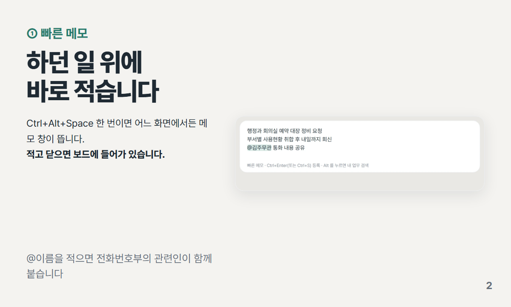
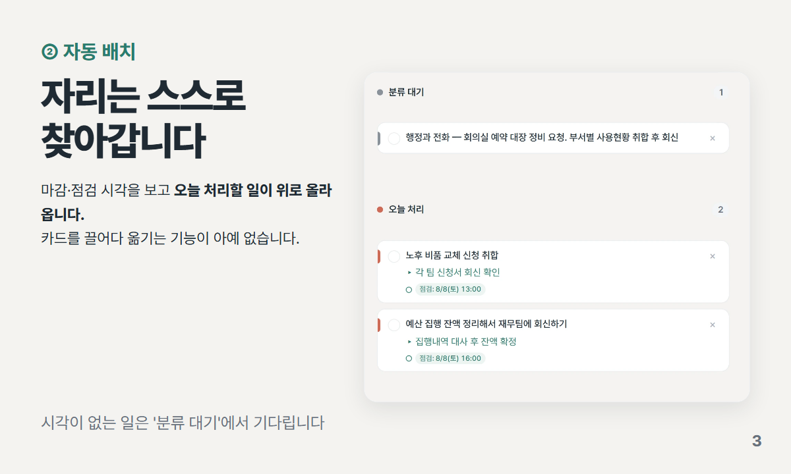
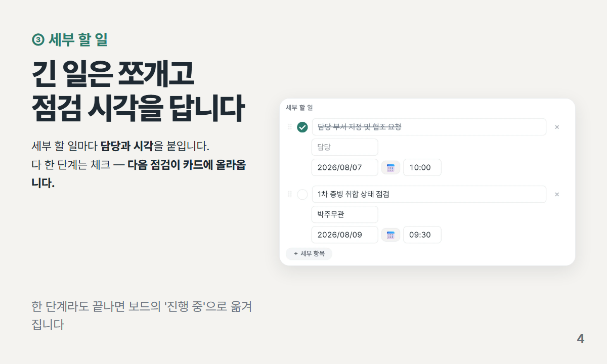
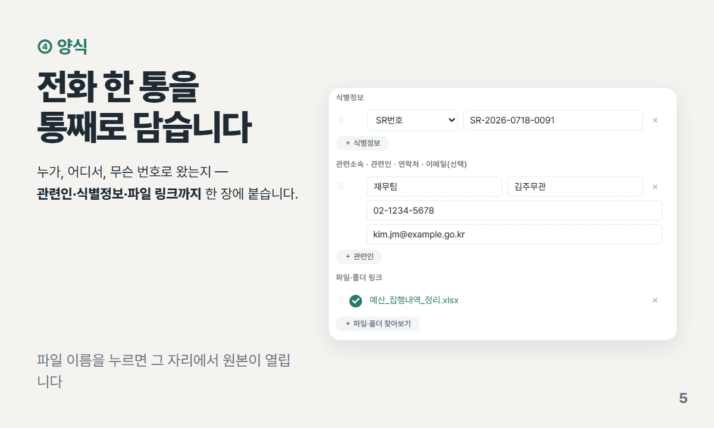
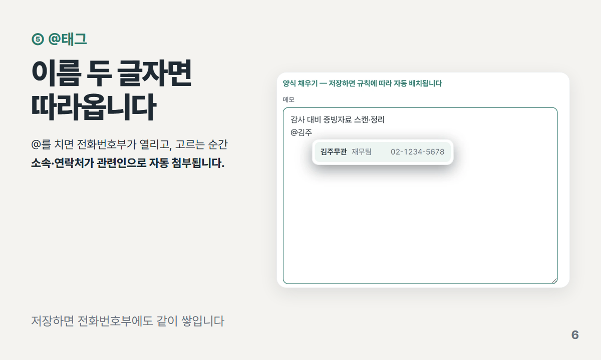
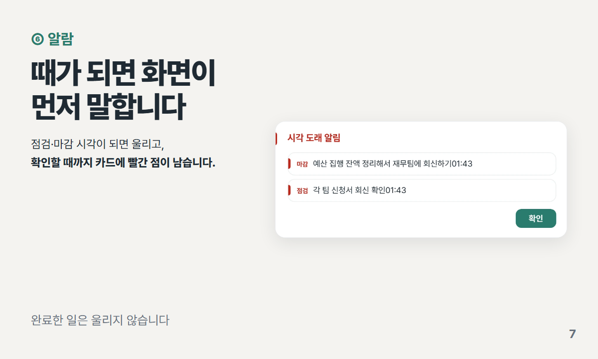
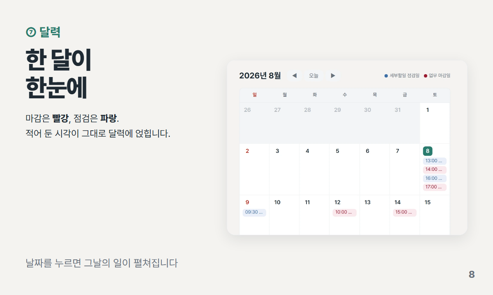
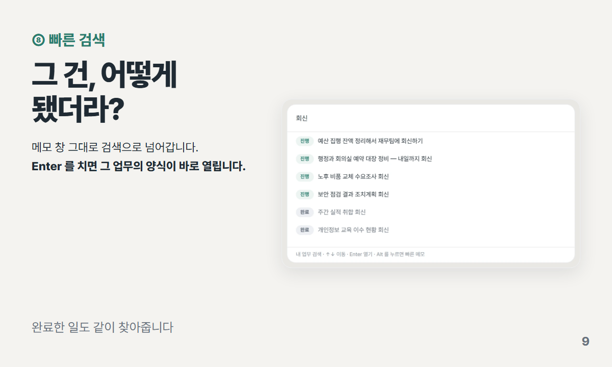
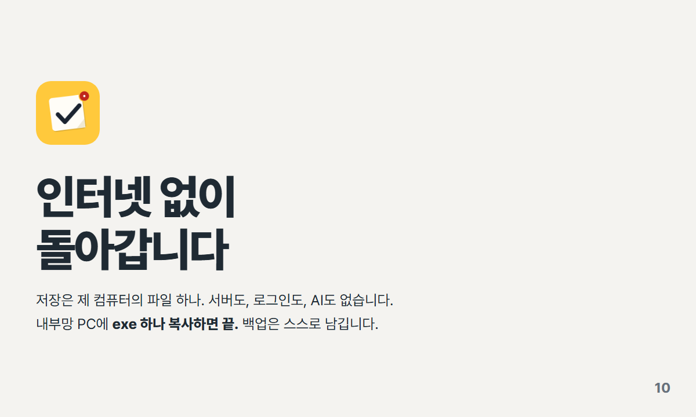

&nbsp;

&nbsp;

## 이런 적, 있으시죠

- **전화를 받는 중에** "아 이거 해야 하는데" 싶은 일이 생기는데, 메모할 곳을 찾는 사이 통화가 끝난다
- **적어는 뒀는데** 포스트잇·메모장·수첩에 흩어져 있어서, 오늘 뭘 해야 하는지는 결국 다시 훑어야 안다
- **할 일 앱을 써 보자니** 계정을 만들라 하고, 적은 내용이 클라우드로 나가고, 애초에 **인터넷이 안 되는 PC**라 설치조차 못 한다

공무원 내부망(인터넷 차단·관리자 권한 없는 PC)에서 쓰려고 만든 **혼자 쓰는 업무 보드**입니다.
**exe 파일 하나**로 돌아갑니다.

* * *

## 어떻게 쓰는 건지, 그림으로

> **이 앱이 다른 할 일 앱과 가장 다른 점입니다 — 카드를 끌어다 옮기는 기능이 아예 없습니다.**
> 시각만 적어 두면 프로그램이 칸을 정합니다. 같은 칸에서는 **먼저 다가오는 일이 맨 위**라, 위에서부터 하시면 됩니다.

* * *

## 보드의 칸

카드는 **손으로 옮기지 않습니다.** 적어 둔 시각과 지금 시각을 견줘 매번 다시 계산합니다.
처음에는 내 일과 남에게 맡긴 일을 나눠 보는 **담당자 · 시간**(5칸)으로 열립니다(v3.7.0부터 기본).

| 칸 | 여기에 오는 일 |
|---|---|
| **분류 대기** | 기한도 점검일도 없고, 아직 손도 대지 않은 일 |
| **본인 진행 · 오늘** | 담당이 나, 오늘 처리할(또는 지난) 일 |
| **타인 진행 · 오늘** | 남에게 넘겨둔 일 중 오늘 챙겨야 하는 일 |
| **본인 진행 · 오늘 외** | 담당이 나, 오늘 처리할 시각이 없는 일 |
| **타인 진행 · 오늘 외** | 남에게 넘겨둔 일 중 오늘 처리할 시각이 없는 일 |

혼자 처리하는 일이 대부분이면 [설정] → 화면 → 보드 배치에서 **시간**(4칸: 분류 대기 · 오늘 처리 · 진행 중 · 예정 · 대기)으로 바꿉니다.

## v3.8에서 달라진 것

위 카드 그림은 v3.6 화면입니다. 지금 화면은 사용설명서의 그림(v3.8.18)을 보세요. v3.8.0~v3.8.18에서 바뀐 것(자세한 내용은 사용설명서와 CHANGELOG):

- **[문서] 탭(새로)**: 업무 파일 폴더를 등록해 왼쪽 폴더 트리 · 가운데 보기 · 오른쪽 그 폴더의 업무 메모를 한 화면에.
  - 한글(HWP·HWPX)은 한컴 없이 쪽 모양 그대로, PDF는 쪽마다. PDF·한글 글자를 끌어 골라 복사.
  - 글자 파일(txt·md·csv·sql 등)은 보는 즉시 고치고 자동 저장. 원래 인코딩 그대로, 다른 프로그램이 그새 고쳤으면 덮어쓰지 않음.
  - 오른쪽 클릭으로 새 폴더·새 한글·엑셀 문서 만들기, 이름 바꾸기, 복제, Windows 휴지통으로 보내기. 탐색기에서 끌어 와 복사(Shift = 옮기기).
  - **문서 찾기**(Ctrl+F): 등록한 모든 폴더에서 파일 이름과 글자 파일 내용까지.
  - 문서를 보면서 오른쪽 칸에서 바로 업무 양식을 씀. 양식 파일 링크의 **[문서]** 버튼으로 그 파일 자리로 이동.
- **캘린더**: [진행 중 | 완료] 보기, 하루 시간표의 빈 자리를 눌러 그 시각으로 새 업무, 이름표의 ×.
- **완료 탭**: 카드 대신 한 줄 목록, 오늘 · 이번 주 · 주별 묶음, 오른쪽 한 달 캘린더 띠(날짜를 누르면 그날 것만, 다른 달로 넘기면 그 달에 끝낸 것만 — v3.8.18).
- **전화번호부**: 탭이 맨 오른쪽으로(보드 · 캘린더 · 문서 · 완료 · 전화번호부), 줄을 누르면 오른쪽 칸에 그 사람과 관련 업무(식별정보·완료 날짜 포함). 목록 4 : 오른쪽 칸 6, [수정]·[바꾸기]·[삭제]는 오른쪽 칸에 마우스를 올렸을 때(v3.8.18). [새로고침] 버튼은 없앰.
- **화면**: [＋ 입력]과 검색칸은 탭 줄 오른쪽으로 — 검색칸 하나가 지금 탭을 찾음. 프리셋은 요약 숫자 줄 오른쪽. 5칸 보드 색은 오늘 = 주홍, 오늘 외 = 청록, 본인 진하게 · 타인 옅게.
- **양식**: 묶음 제목 줄의 [＋ 추가], 메모칸 높이 손잡이(⇕).

## v3.7에서 달라진 것

v3.7.0~v3.7.5에서 바뀐 것(일부는 v3.8에서 다시 바뀌었습니다 — 위 목록 참고):

- **화면**: 흰 패널과 회색 바탕의 새 디자인, 보드 위 요약 숫자 줄('진행 중 업무' · '오늘 업무' · '오늘 완료' · '시각 지남'), 색각 안전 팔레트의 칸 색. 기본 화면 크기 130%(Ctrl+휠로 90~140%).
- **입력**: 메인 화면의 '바로 입력' 칸을 없애고 **[＋ 입력]**(Ctrl+N)과 빠른 메모(Ctrl+Alt+Space)로 정리. 업무 검색은 Ctrl+F.
- **업무 끝내기**: 양식의 **[✓ 업무 완료]**, 완료한 업무를 그 자리에서 되살리는 **[↺ 다시 진행]**.
- **파일**: 탐색기에서 파일·폴더를 카드나 양식에 끌어다 놓으면 링크로 붙음.
- **메모 2쪽 보기**: 긴 메모를 A4 비율 쪽 두 장씩 펼쳐 읽고 그 자리에서 고침.
- **전화번호부**: 소속별 묶음, [＋ 추가] 팝업, 사람이 바뀌었을 때 모든 업무에 반영하는 **[바꾸기]**.
- **캘린더·완료**: 캘린더 옆 하루 시간표, 완료 업무를 오늘 · 이번 주 · 이번 달로 묶음.
- **시작**: 컴퓨터를 켜면 자동 실행(기본 켬, 관리자 권한 불필요).
- **빠른 검색**: 결과 상한 15건 → 100건.

* * *

## 시작하기

1. [`최종 프로그램 산출물/`](./최종%20프로그램%20산출물) 에서 `뭐하려 했더라v3.8.25.exe` 를 받습니다.
2. 아무 폴더(바탕화면·D드라이브 등)에 두고 더블클릭합니다. **설치도, 관리자 권한도 필요 없습니다.**
3. 첫 실행 때 데이터를 보관할 폴더를 물어봅니다. 고른 폴더 안에 `뭐하려했더라_데이터` 가 생기고
   **데이터와 자동 백업이 전부 거기에만** 저장됩니다. 건너뛰어도 되고, 나중에 [설정]에서 옮길 수 있습니다.

**내 데이터는**

- 저장은 **내 PC의 SQLite 파일 하나**입니다. 바깥으로 나가는 통신이 없습니다.
- 고치는 즉시 저장됩니다 — 저장 버튼도, 동기화도 없습니다.
- **자동 백업**이 쌓입니다(최근 것 + 날짜별 첫 백업 2주치). 파일이 깨지면 **성한 백업을 찾아 스스로 복구**하고, 덮기 전에 원본도 따로 남깁니다.
- PC를 옮길 땐 [설정] → **백업 파일 만들기**로 내보내고 새 PC에서 **백업에서 복원**으로 불러오면 됩니다. 데이터 폴더째 복사해도 됩니다.

* * *

## 개발

프론트는 빌드 도구 없는 브라우저 네이티브 ES 모듈(`src/`), 백엔드는 Tauri + Rust + SQLite(`src-tauri/`)입니다.

| 작업 | 명령 |
|---|---|
| 개발 실행 (핫리로드) | `npm run tauri dev` |
| 프론트 테스트 (node:test + jsdom, 384개) | `npm test` |
| 백엔드 테스트 (DB 라운드트립·문서 명령, 64개) | `cd src-tauri && cargo test --lib` |
| 미니 창 레이아웃 검사 (실렌더 31상태) | `node tools/capture-check.mjs` |
| @자동완성·관련 업무 팝업 실조작 검사 (21항목) | `node tools/interact-check.mjs` |
| 저장 성능 회귀 검사 | `node tools/save-perf-check.mjs` |
| 메모 2쪽 보기 편집 검사 | `node tools/book-check.mjs` |
| 사용설명서 그림 다시 찍기 · PDF 다시 만들기 | `node tools/guide-shots.mjs` · `node tools/build-user-guide-pdf.mjs` |
| 화면 가로 넘침 검사 (실제 Edge) | `node tools/win-render.mjs` |
| 릴리스 빌드 | `npm run tauri build` |

위 README 카드는 `milkbuttercheese-shared/tools/cardnews` 로 굽습니다 — 원본 갈무리는 `tools/cardnews-shots.mjs`(앱 실행 없이
예시 데이터로 촬영), 카드 조판은 `milkbuttercheese-shared/tools/cardnews/뭐하려했더라-readme.mjs` 설정을 씁니다.

* * *

## 문서

| 문서 | 무엇 |
|---|---|
| [`뭐하려 했더라 사용설명서.pdf`](./뭐하려%20했더라%20사용설명서.pdf) | **처음 쓰는 분용** — 상황별("이럴 땐 이렇게") 사용법·화면 그림·FAQ |
| [`CHANGELOG.md`](./CHANGELOG.md) | 버전별 변경 이력 |
| [`디자인 정책.md`](./디자인%20정책.md) | 색·글자·곡률·버튼 역할 규칙 |
| [`구조 분석 보고서.md`](./구조%20분석%20보고서.md) | 코드베이스 구조·안정성 분석 |
| [`시장 리서치 보고서.md`](./시장%20리서치%20보고서.md) | 유사 서비스 조사 — 포지셔닝·기능 로드맵 |
| [`기능 제안서.md`](./기능%20제안서.md) | 공공기관 내부망 관점의 기능 추가 vs 단순 유지 검토 |
| `CLAUDE.md` | 개발 규칙·아키텍처 가이드 (AI 협업용) |

* * *

## 라이선스

[GNU AGPL v3](./LICENSE). 소스를 재배포하거나 네트워크 서비스로 제공하려면 소스를 같은 라이선스로
공개해야 합니다. 개인·기관 내부에서 쓰는 것은 그런 의무가 없습니다.

화면 갈무리는 모두 <b>예시 데이터</b>입니다 — 실제 업무 내용이 아닙니다.

