

  <picture>
    <source media="(prefers-color-scheme: dark)" srcset="docs/readme/hero-dark.png">
    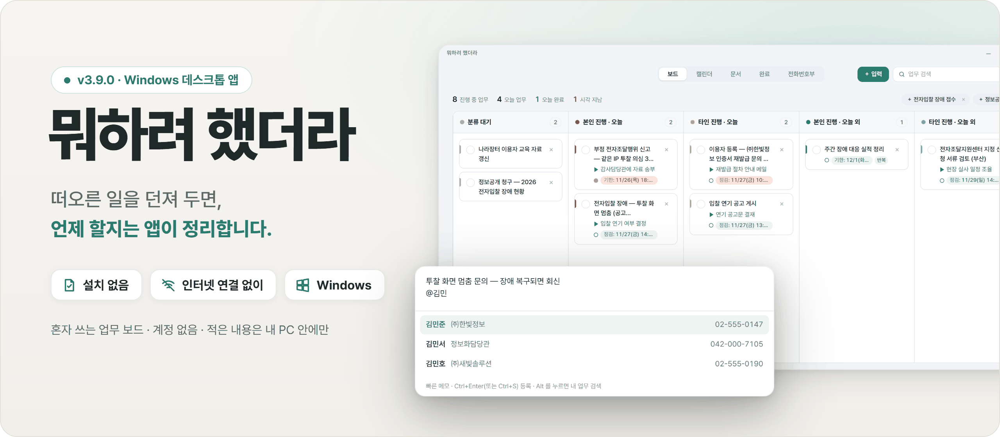
  </picture>

  <a href="https://github.com/Milkbuttercheese2/What-I-have-to-do/releases/latest"><picture><source media="(prefers-color-scheme: dark)" srcset="docs/readme/btn-download-dark.png"></picture></a>
  <a href="https://github.com/Milkbuttercheese2/What-I-have-to-do/releases/tag/v3.9.0"><picture><source media="(prefers-color-scheme: dark)" srcset="docs/readme/btn-video-dark.png"></picture></a>
  <a href="./뭐하려%20했더라%20사용설명서.pdf"><picture><source media="(prefers-color-scheme: dark)" srcset="docs/readme/btn-guide-dark.png"></picture></a>

  
  
  

  <a href="#30초-요약">30초 요약</a> ·
  <a href="#써-보면">써 보면</a> ·
  <a href="#기능-전체">기능 전체</a> ·
  <a href="#받기">받기</a> ·
  <a href="#처음-쓰기">처음 쓰기</a> ·
  <a href="#내-데이터">내 데이터</a> ·
  <a href="#자주-묻는-것">자주 묻는 것</a> ·
  <a href="#개발자용">개발자용</a>

&nbsp;

공무원 내부망처럼 인터넷이 끊기고 관리자 권한이 없는 PC에서 쓰려고 만든 혼자 쓰는 업무 보드입니다.
전화를 받다가 생긴 일을 바로 적어 두면, 어느 칸에 두고 언제 챙길지는 앱이 정합니다. 계정을 만들지 않고, 적은 내용은 내 PC 밖으로 나가지 않습니다.

## 30초 요약

  <picture>
    <source media="(prefers-color-scheme: dark)" srcset="docs/readme/flow-dark.png">
    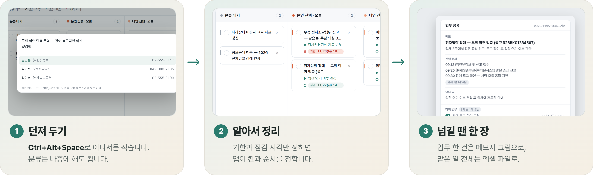
  </picture>

카드를 손으로 옮기는 기능이 없습니다. 기한과 하위 업무의 점검 시각만 적어 두면 앱이 오늘 할 일과 나중 일을 가르고, 같은 칸에서는 먼저 다가오는 일을 위에 세웁니다. 시각이 되면 알림창을 띄웁니다.

## 써 보면

  <picture><source media="(prefers-color-scheme: dark)" srcset="docs/readme/demo-capture-dark.gif">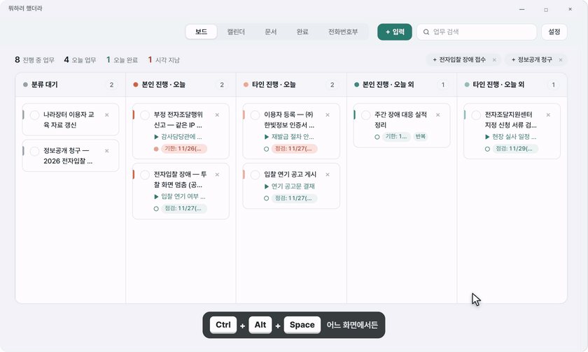</picture>
   <b>① 적기</b> — 어느 화면에서든 <kbd>Ctrl</kbd>+<kbd>Alt</kbd>+<kbd>Space</kbd>로 적고, <code>@이름</code>으로 연락처를 붙입니다.

  <picture><source media="(prefers-color-scheme: dark)" srcset="docs/readme/demo-share-dark.gif">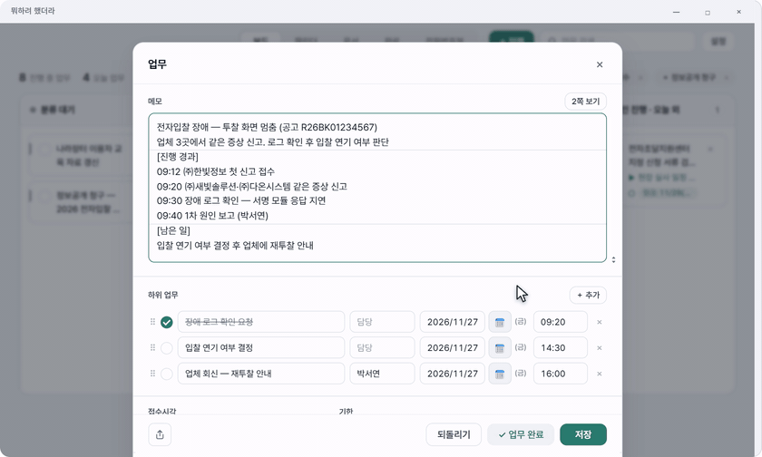</picture>
   <b>② 넘기기</b> — 공유를 누르면 업무가 메모지 한 장이 되고, 그림으로 복사해 대화창에 붙입니다.

  <picture><source media="(prefers-color-scheme: dark)" srcset="docs/readme/demo-docs-dark.gif">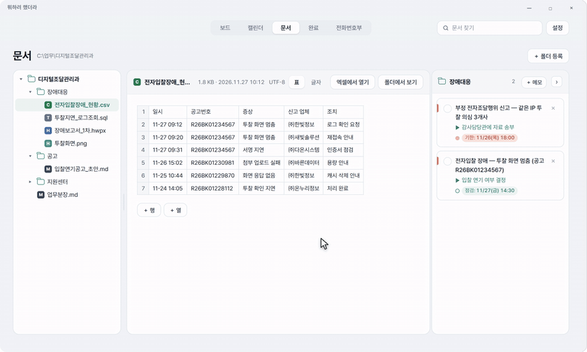</picture>
   <b>③ 문서</b> — 업무 폴더를 앱 안에서 열고, 파일 이름과 내용까지 찾습니다.

## 기능 전체

v3.9.0에 있는 기능을 묶음 여덟으로 나눠 모두 적었습니다. 화면 그림은 모두 지어낸 예시 데이터입니다.

[적기](#적기) · [정리하기](#정리하기) · [잊지 않기](#잊지-않기) · [다시 찾기](#다시-찾기) · [문서](#문서) · [넘기기](#넘기기) · [지키기](#지키기) · [내게 맞추기](#내게-맞추기)

### 적기

<picture>
  <source media="(prefers-color-scheme: dark)" srcset="docs/readme/feat-capture-dark.png">
  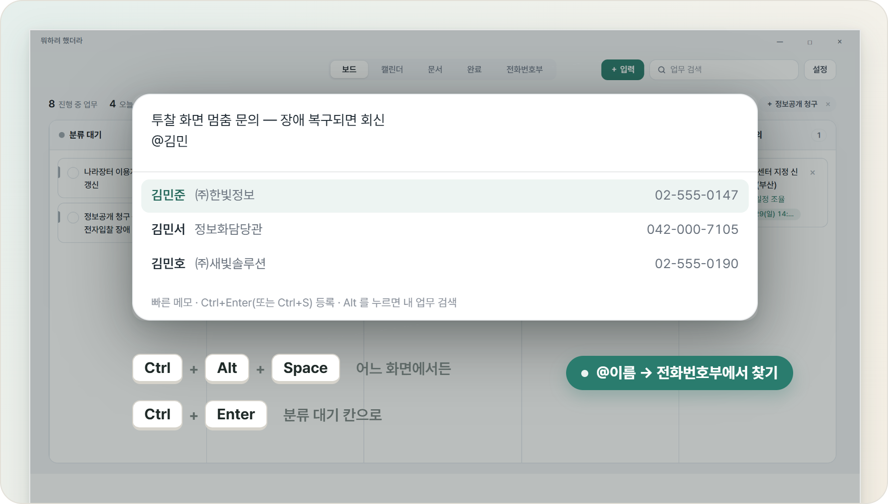
</picture>

- **빠른 메모** — <kbd>Ctrl</kbd>+<kbd>Alt</kbd>+<kbd>Space</kbd>로 어느 화면에서든 작은 창을 띄워 적고, <kbd>Ctrl</kbd>+<kbd>Enter</kbd>로 보드의 '분류 대기' 칸에 넣습니다.
- **내 업무 검색** — 같은 창에서 <kbd>Alt</kbd>로 바꾸면 진행 중인 업무와 완료한 업무를 함께 찾고(최대 100건), <kbd>Enter</kbd>로 그 업무를 엽니다.
- **먼저 뜨는 화면 고르기** — 단축키를 누르면 업무 검색·빠른 메모·양식 가운데 무엇을 먼저 띄울지, <kbd>Alt</kbd>로 무엇과 오갈지 [설정]에서 고릅니다.
- **@이름 자동완성** — 메모에 `@`와 이름 두 글자(또는 번호 세 자리)를 치면 전화번호부에서 찾아 주고, 고른 사람의 소속·연락처가 관련인으로 붙습니다.
- **쓰던 메모 지킴** — 창을 닫거나 다른 창으로 넘어가도 쓰던 메모가 남고, 쓰다 만 채로 컴퓨터가 꺼지면 다음 실행 때 '분류 대기'에 들어갑니다.
- **[＋ 입력]** — 보드의 [＋ 입력]이나 <kbd>Ctrl</kbd>+<kbd>N</kbd>으로 빈 양식을 열어 처음부터 자세히 적습니다.
- **프리셋** — 자주 쓰는 업무 틀을 저장해 두면 요약 숫자 줄 오른쪽 단추 한 번으로 하위 업무까지 채운 양식이 열립니다.
- **끌어다 놓아 링크** — 탐색기에서 파일·폴더를 카드나 양식 위에 놓으면 링크로 붙고, 보드의 빈 곳에 놓으면 그 링크를 담은 새 양식이 열립니다.

### 정리하기

<picture>
  <source media="(prefers-color-scheme: dark)" srcset="docs/readme/feat-form-dark.png">
  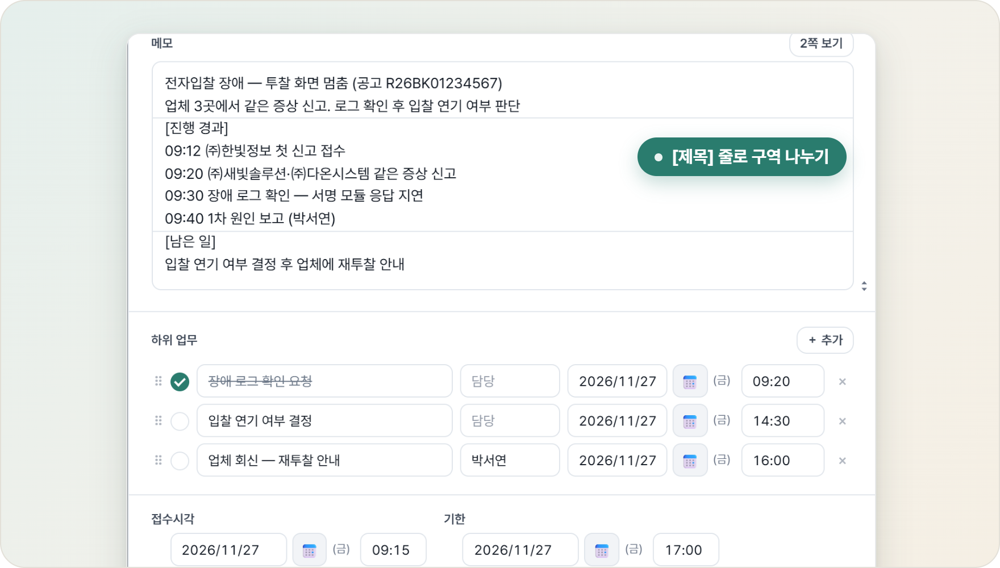
</picture>

- **자동 배치 보드** — 기한과 하위 업무의 점검 시각을 보고 앱이 칸을 정하고, 같은 칸에서는 먼저 다가오는 일이 위에 섭니다. 카드를 손으로 옮기지 않습니다.
- **두 가지 배치** — 담당자 · 시간(다섯 칸: 분류 대기, 본인·타인 × 오늘·오늘 외)과 시간(네 칸: 분류 대기, 오늘 처리, 진행 중, 예정 · 대기) 가운데 고릅니다.
- **요약 숫자 줄** — 보드 위에 진행 중 업무·오늘 업무·오늘 완료·시각 지남이 숫자로 보입니다.
- **카드** — 메모 첫 줄과 다음 하위 업무, 가장 이른 시각만 보이고, 지났거나 2시간 안에 닥친 시각은 붉게 표시됩니다.
- **업무 양식** — 메모, 하위 업무, 접수시각·기한, 식별정보, 관련소속·관련인·연락처·이메일, 파일·폴더 링크를 업무 하나에 묶습니다.
- **하위 업무** — 단계마다 점검 시각과 담당자(비우면 본인)를 적고, 가장 먼저 다가오는 단계의 담당자에 따라 본인·타인 칸이 정해집니다.
- **식별정보** — 입찰공고번호·SR번호 같은 번호를 업무에 달고, 쓸 번호 종류는 [설정] → 프리셋 · 식별정보에서 정합니다.
- **메모 구역 제목** — 한 줄을 통째로 `[진행 경과]`처럼 쓰면 그 줄 위에 가는 선이 그어져 메모가 구역으로 나뉘어 보입니다. 저장되는 글자는 그대로입니다.
- **2쪽 보기** — 긴 메모를 A4 비율 쪽 두 장씩 펼쳐 읽고, 그 자리에서 고칩니다.
- **메모칸 높이** — 메모칸 옆 손잡이(⇕)를 끌어 높이를 바꾸고, 두 번 누르면 원래 높이로 돌아갑니다.
- **순서 바꾸기** — 하위 업무·관련인·식별정보·프리셋은 왼쪽 손잡이(⠿)를 끌어 순서를 바꿉니다.
- **임시저장과 되돌리기** — 양식에 적는 내용은 잠시 뒤 임시저장되어 닫거나 앱을 꺼도 남고, [되돌리기]는 마지막으로 저장한 내용으로 돌아갑니다.
- **카드 합치기** — 같은 일을 두 번 적었으면 카드를 끌어 다른 카드 위에 놓아 하나로 합칩니다. 기한은 이른 쪽을, 하위 업무·관련인은 겹친 것을 빼고 모두 씁니다.
- **업무 완료와 다시 진행** — 카드 왼쪽 동그라미나 양식의 [✓ 업무 완료]로 끝내고, 잠긴 완료 업무는 [↺ 다시 진행]으로 되살려 고칩니다.
- **실행 취소** — 업무 완료, 카드 지우기, 카드 합치기 직후 알림에서 [실행 취소]로 되돌립니다.

### 잊지 않기

<picture>
  <source media="(prefers-color-scheme: dark)" srcset="docs/readme/feat-calendar-dark.png">
  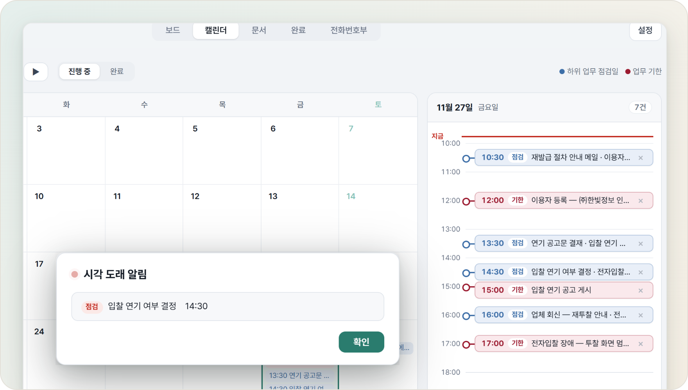
</picture>

- **알림** — 기한이나 점검 시각이 되면 앱 창이 앞으로 나와 알림창을 띄우고, 소리와 작업 표시줄 깜빡임으로 알립니다.
- **알림 상태 점** — 카드의 작은 점이 대기(빈 점)·울리는 중(빨강)·확인함(초록)을 보여 줍니다. 알림 전체는 [설정] → 알림에서 켜고 끕니다.
- **반복 업무** — 매주 요일이나 매월 며칠(그 달에 없는 날은 말일)과 시각을 정해 두면 그때마다 보드에 업무가 생기고, 카드에 '반복' 꼬리표가 붙습니다.
- **반복 업무가 생기는 때** — 주초(월요일)에 한 주치 한꺼번에·하루 전·당일 가운데 고르고, 같은 화면에서 수정·일시정지·삭제와 다음 예정일 확인을 합니다.
- **캘린더** — 한 달 캘린더에 기한(빨강)과 하위 업무 점검(파랑)이 놓이고, 옆에 고른 날의 하루 시간표(0시~24시, 오늘은 '지금' 선)가 붙습니다.
- **진행 중 | 완료** — 캘린더를 진행 중인 일만, 또는 완료한 업무를 완료한 날과 시각에 놓아 봅니다.
- **빈 시간에서 새 업무** — 하루 시간표의 빈 자리를 누르면 그 시각(30분 단위)이 첫 하위 업무의 점검 시각으로 들어간 양식이 열리고, 캘린더 칸을 두 번 누르면 그날 18:00으로 열립니다.
- **창을 닫아도 동작** — 창의 ×를 눌러도 트레이(시계 옆)에 남아 알림과 단축키를 계속 챙깁니다.

### 다시 찾기

<picture>
  <source media="(prefers-color-scheme: dark)" srcset="docs/readme/feat-find-dark.png">
  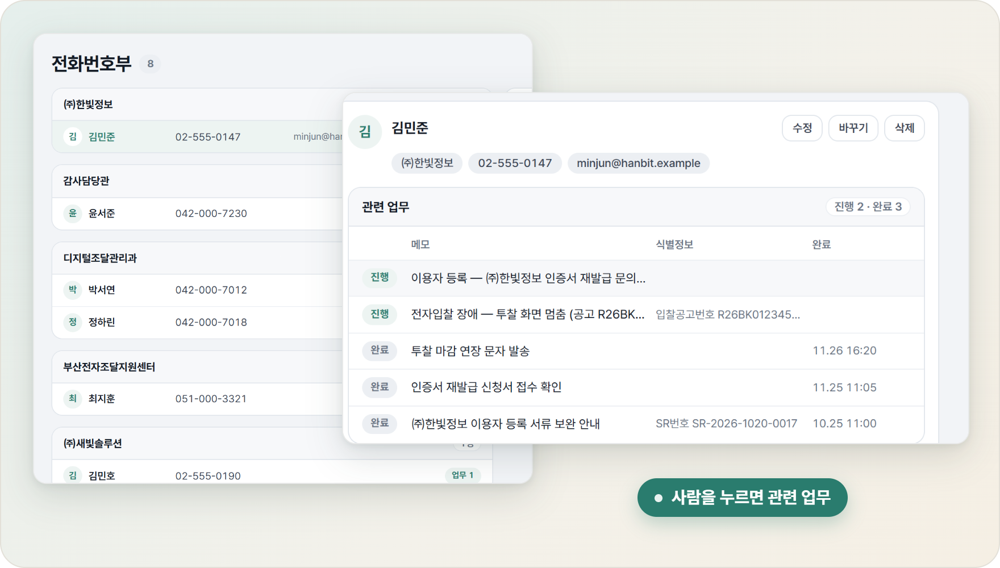
</picture>

- **검색칸 하나** — 탭 줄 오른쪽 검색칸(<kbd>Ctrl</kbd>+<kbd>F</kbd>)이 지금 보는 탭을 찾습니다. 메모·관련인·소속·담당자·번호·파일 이름으로 찾고, 연락처는 숫자만 쳐도 됩니다.
- **완료 탭** — 끝낸 일을 한 줄 목록으로 오늘 · 이번 주 · 주별로 묶어 보여 줍니다.
- **달 단위로 넘기기** — 완료 탭 오른쪽 한 달 캘린더 띠에서 다른 달로 가면 그 달에 완료한 업무만, 날짜를 누르면 그날 것만 보입니다.
- **전화번호부** — 소속별로 묶인 연락처 목록입니다. 사람을 누르면 오른쪽 칸에 그 사람의 관련 업무가 진행 중·완료로 나뉘어 모입니다.
- **@이름으로 관련 업무** — 메모의 `@이름`을 누르면 같은 관련 업무 목록이 팝업으로 뜹니다.
- **담당자 한꺼번에 바꾸기** — [바꾸기]로 예전 사람이 들어 있던 모든 업무(완료 포함)의 관련인과 메모의 `@이름`을 새 사람으로 바꾸고, 직후 [실행 취소]할 수 있습니다.
- **엑셀 가져오기** — [엑셀 양식]을 채우거나 쓰던 명부 파일을 [엑셀 가져오기]로 넣으면, 새로 들어갈 사람을 먼저 보여 준 뒤 추가합니다.
- **저절로 쌓이는 연락처** — 양식에 적은 관련인은 저장할 때 전화번호부에 들어갑니다. 이미 있는 사람은 건너뜁니다.

### 문서

<picture>
  <source media="(prefers-color-scheme: dark)" srcset="docs/readme/feat-docs-dark.png">
  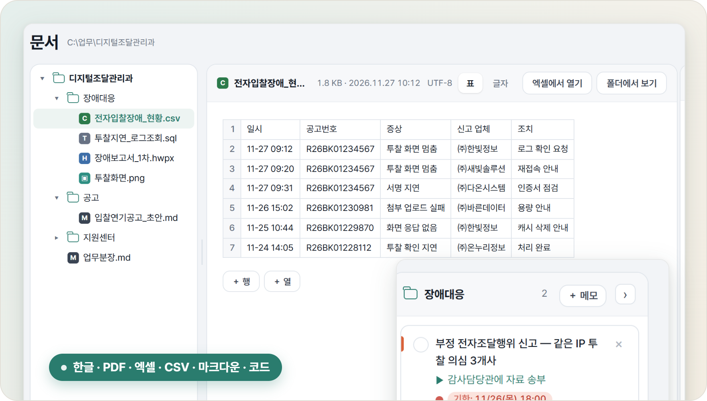
</picture>

- **폴더 등록** — 업무 파일 폴더(내 PC든 공유 폴더든)를 여러 개 등록하면 왼쪽 폴더 트리 · 가운데 보기 · 오른쪽 업무 메모가 한 화면에 놓입니다.
- **한글 쪽 보기** — HWP·HWPX를 한컴오피스 없이 쪽 모양 그대로(표·그림·머리말·각주) 보고, 그리지 못하는 문서는 글자와 표로 보여 줍니다.
- **PDF** — 쪽마다 보고 확대·축소합니다.
- **엑셀·워드** — PC에 Office나 한컴이 있으면 탐색기 미리 보기 그대로, 없으면 글자와 표만 보여 줍니다(엑셀은 시트를 바꿔 가며).
- **원래 프로그램으로** — [한글에서 열기]·[엑셀에서 열기]·[폴더에서 보기]로 바로 넘어갑니다. 파워포인트 파일은 앱 안에서 그리지 않고 이 단추로 엽니다.
- **글자 끌어 고르기** — PDF와 한글 쪽의 글자를 마우스로 끌어 고르고 <kbd>Ctrl</kbd>+<kbd>C</kbd>로 복사합니다.
- **글자 파일 바로 고치기** — txt·md·csv·json·sql 같은 글자 파일은 보는 자리에서 고치면 저장되고, 원래 인코딩(UTF-8·EUC-KR·UTF-16)과 줄바꿈을 그대로 씁니다.
- **덮어쓰지 않기** — 그새 다른 프로그램이 같은 파일을 고쳤으면 내 고침을 '… (내 고침)' 파일로 따로 남기고 원래 파일을 다시 엽니다.
- **CSV 표 · 마크다운 · 코드** — CSV는 표에서 칸을 눌러 고치고, MD·HTML은 [보기]와 [편집]을 오가며, 코드·쿼리 파일은 색으로 구분해 보여 줍니다.
- **그림 · 동영상 · 소리 · ZIP** — 그림·동영상·소리는 앱 안에서 바로 열고, ZIP은 안에 든 파일 목록을 보여 줍니다.
- **문서 찾기** — 문서 탭에서 <kbd>Ctrl</kbd>+<kbd>F</kbd>를 누르면 등록한 모든 폴더에서 파일 이름과 1MB 이하 글자 파일의 내용까지 찾습니다(최대 200개).
- **보면서 메모** — 오른쪽 칸에 그 폴더를 링크로 가진 업무가 카드로 보이고, [＋ 메모]를 누르면 문서 옆에 양식이 붙어 바로 적습니다.
- **양식에서 문서로** — 업무의 파일 링크가 등록한 폴더 안을 가리키면 [문서] 단추가 생겨 문서 탭의 그 자리로 넘어갑니다.
- **만들기 · 이름 바꾸기 · 복제 · 휴지통** — 트리에서 오른쪽 클릭으로 새 폴더·글자 문서·메모(.md)·한글·엑셀·파워포인트 문서를 만들고, 이름 바꾸기(<kbd>F2</kbd>)·복제·Windows 휴지통으로 보내기(<kbd>Delete</kbd>)를 합니다.
- **끌어 넣기와 옮기기** — 탐색기에서 끌어 오면 그 폴더로 복사하고(<kbd>Shift</kbd>를 누르면 옮기기), 트리 안에서 끌어 옮긴 것은 [실행 취소]할 수 있습니다.
- **링크가 따라옴** — 앱 안에서나 탐색기에서 이름을 바꾸면 그 경로를 가리키던 업무의 파일 링크도 새 이름으로 바뀝니다.
- **바깥 바뀜 따라가기** — 탐색기 같은 다른 프로그램에서 파일을 만들거나 지우면 트리에 바로 보이고, 보던 파일이 바뀌면 다시 읽어 옵니다.

### 넘기기

<picture>
  <source media="(prefers-color-scheme: dark)" srcset="docs/readme/feat-handover-dark.png">
  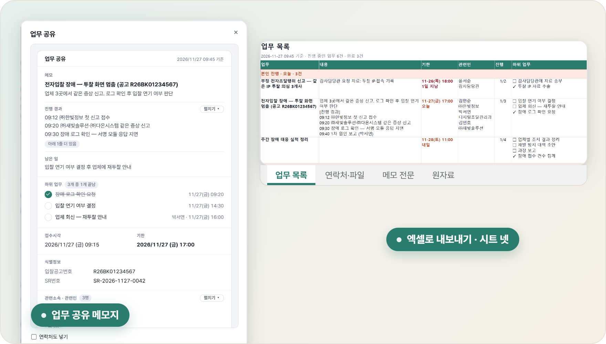
</picture>

- **업무 공유 메모지** — 양식 아래 공유 아이콘을 누르면 업무가 메모지 한 장으로 정리되고, [그림 복사]로 메신저 대화창에 붙여 넣습니다.
- **글자로 복사 · 파일로 저장** — 같은 내용을 글자로 복사하거나 PNG 파일로 저장합니다. 그림 복사가 안 되는 PC에서는 파일을 끌어다 놓습니다.
- **빼고 보내기** — 연락처·이메일·파일 링크는 기본으로 빠지고, '연락처도 넣기'를 켜면 연락처와 이메일만 들어갑니다.
- **접고 펼치기** — 긴 메모와 많은 관련인은 접혀 '아래 N줄 더 있음'·'외 N명'으로 적히고, 미리 보기의 [펼치기]로 그림에 모두 싣습니다.
- **엑셀로 내보내기** — [설정] → 데이터 → [엑셀로 내보내기]가 업무 목록 · 연락처·파일 · 메모 전문 · 원자료 시트를 담은 파일을 만듭니다.
- **보드 순서 그대로** — 첫 시트 '업무 목록'은 보드 칸 순서대로 묶이고, 지난 기한은 붉게, 오늘과 내일은 주홍으로 적히며, A4 가로 한 장 폭에 맞춰 인쇄됩니다.
- **긴 메모도 빠짐없이** — 엑셀 칸 하나에 들어가지 않는 긴 메모는 '메모 전문' 시트에 모두 담깁니다.

### 지키기

<picture>
  <source media="(prefers-color-scheme: dark)" srcset="docs/readme/feat-safe-dark.png">
  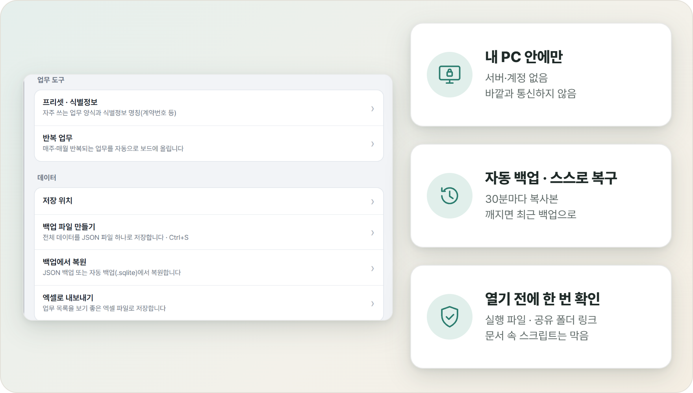
</picture>

- **내 PC 안에만** — 서버와 계정이 없습니다. Windows용 빌드에는 HTTP 통신 라이브러리가 들어 있지 않고, 앱 화면의 보안 정책(CSP)은 앱 자신과 앱 내부 통로만 엽니다.
- **자동 저장** — 화면에서 바꾼 것은 즉시 저장되고(양식만 [저장]으로 확정), 저장이 막히면 경고를 띄운 채 잠시 뒤 다시 시도합니다.
- **비상 파일** — 그래도 저장이 안 되면 데이터를 데이터 폴더의 `emergency` 폴더에 파일로 남기고, 그 파일도 [백업에서 복원]으로 되살립니다.
- **자동 백업** — 저장할 때마다(30분에 한 번까지) 복사본을 만들어 최근 20개와 날짜별 첫 백업 14일치를 남깁니다.
- **스스로 복구** — 데이터 파일이 깨진 채로 켜지면 검사를 통과한 가장 최근 백업으로 복구하고, 원래 파일은 지우지 않고 따로 남깁니다.
- **백업 파일과 복원** — [백업 파일 만들기] 또는 <kbd>Ctrl</kbd>+<kbd>S</kbd>로 전체를 JSON 파일 하나로 저장하고, [백업에서 복원]으로 JSON 백업이나 자동 백업을 되살립니다.
- **덮어쓰기 막기** — 다른 창이나 옛 버전이 그새 데이터를 바꿨으면 저장을 멈추고, 지금 화면 내용을 파일로 남긴 뒤 최신 데이터를 다시 불러옵니다.
- **한 번에 하나만** — 이미 켜져 있으면 새로 뜨지 않고 켜져 있던 창이 앞으로 나옵니다.
- **열기 전 확인** — 실행 파일·매크로 문서 같은 링크와 처음 여는 공유 폴더(`\\서버\…`) 링크는 한 번 묻고 엽니다.
- **문서 속 스크립트 막기** — 문서 탭의 HTML·마크다운 보기는 앱 기능에 닿지 못하게 따로 가둬 그립니다.
- **진단 로그** — 오류 기록 `wmhh.log`에는 어디서 난 오류인지와 오류 문구만 적고, 업무 내용은 적지 않습니다.

### 내게 맞추기

<picture>
  <source media="(prefers-color-scheme: dark)" srcset="docs/readme/feat-custom-dark.png">
  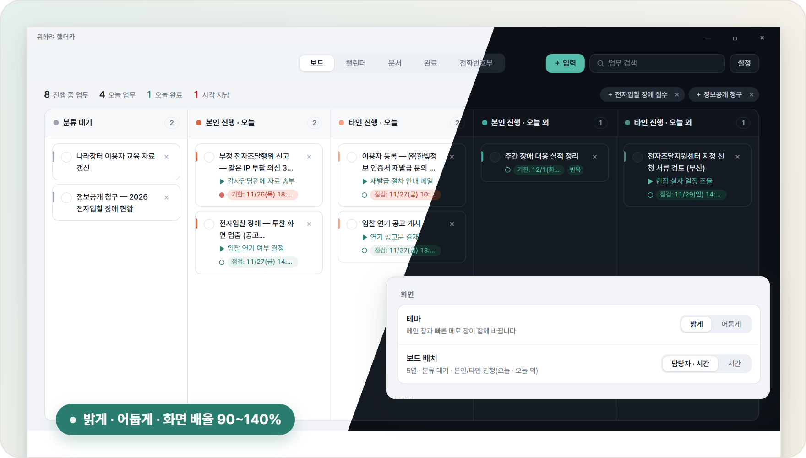
</picture>

- **밝게 · 어둡게** — [설정] → 화면 → 테마를 바꾸면 미니 창까지 함께 바뀝니다.
- **화면 배율** — <kbd>Ctrl</kbd>+마우스 휠로 화면 전체를 90~140%(처음 130%) 사이에서 키우고 줄이며, 미니 창도 같은 배율을 따릅니다.
- **전체화면과 컴팩트** — 제목 줄의 □ 단추로 넓은 보드와 폭 560px의 한 칸 보기를 오갑니다.
- **자동 실행 · 트레이** — 컴퓨터를 켜면 관리자 권한 없이 자동으로 실행되고(끌 수 있음), 자동 실행 때 창을 열지 트레이에 숨길지 고릅니다.
- **저장 위치** — 첫 실행 때 데이터 폴더를 고르고, 나중에 [설정] → 데이터 → [저장 위치]에서 옮깁니다.
- **화면 읽기 프로그램** — 팝업이 열리면 '대화 상자'와 그 제목을 알리고, 입력칸마다 이름표가 붙어 있습니다.

## 받기

1. [최신 릴리스](https://github.com/Milkbuttercheese2/What-I-have-to-do/releases/latest)에서 exe 파일(`wmhh-desktop-v3.9.0.exe`)을 받습니다.
   저장소의 [`최종 프로그램 산출물/`](./최종%20프로그램%20산출물) 폴더에도 같은 버전의 exe(`뭐하려 했더라v3.9.0.exe`)가 있습니다.
2. 아무 폴더(바탕 화면, D 드라이브 등)에 두고 더블클릭합니다. 설치 과정이 없고 관리자 권한도 필요 없습니다.
3. 예전 버전 exe가 있으면 지웁니다. 옛 exe를 다시 켜면 새 버전이 저장한 내용을 덮어쓸 수 있습니다.

화면은 Windows의 WebView2(Microsoft Edge 엔진)로 그립니다. exe에는 WebView2가 들어 있지 않으므로 PC에 WebView2가 있어야 합니다.
[v3.9.0 릴리스](https://github.com/Milkbuttercheese2/What-I-have-to-do/releases/tag/v3.9.0)에는 소개영상(`wmhh-intro-v3.9.0.mp4`, 휴대폰용 `wmhh-intro-v3.9.0-mobile.mp4`)도 함께 올라 있습니다.

## 처음 쓰기

1. **exe를 실행합니다.** 아무 폴더에 둔 exe를 더블클릭합니다.
2. **데이터 폴더를 고릅니다.** 첫 실행 때 업무 데이터를 보관할 위치를 묻습니다. 고른 폴더 안에 `뭐하려했더라_데이터` 폴더가 생기고, 데이터와 자동 백업이 모두 그 안에 저장됩니다. 선택을 취소하면 Windows 기본 앱 데이터 폴더(`%LOCALAPPDATA%\com.wooseongkyun.wmhh`)를 씁니다. 나중에 [설정] → 데이터 → [저장 위치]에서 옮길 수 있습니다.
3. **첫 메모를 적습니다.** <kbd>Ctrl</kbd>+<kbd>Alt</kbd>+<kbd>Space</kbd>로 창을 띄우고 <kbd>Alt</kbd>로 빠른 메모로 바꾼 뒤, 적고 <kbd>Ctrl</kbd>+<kbd>Enter</kbd>를 누릅니다. 메모는 보드의 '분류 대기' 칸에 들어갑니다. 카드를 눌러 양식에서 기한이나 하위 업무의 점검 시각을 정하면 알맞은 칸으로 옮겨 갑니다.

앱은 컴퓨터를 켜면 자동으로 실행됩니다. 원하지 않으면 [설정] → 시작에서 끕니다. 상황별 사용법은 [사용설명서 PDF](./뭐하려%20했더라%20사용설명서.pdf)에 있습니다.

<b>보드의 칸</b> — 카드가 어느 칸에 놓이는지

&nbsp;

카드는 적어 둔 시각과 지금 시각을 견줘 매번 다시 계산한 칸에 놓입니다. 처음에는 **담당자 · 시간**(다섯 칸)으로 열립니다.

| 칸 | 여기에 오는 일 |
|---|---|
| **분류 대기** | 기한도 점검 시각도 없고, 아직 손대지 않은 일 |
| **본인 진행 · 오늘** | 담당이 나이고, 오늘 처리할(또는 시각이 지난) 일 |
| **타인 진행 · 오늘** | 남에게 맡긴 일 가운데 오늘 챙겨야 하는 일 |
| **본인 진행 · 오늘 외** | 담당이 나이고, 오늘 처리할 시각이 없는 일 |
| **타인 진행 · 오늘 외** | 남에게 맡긴 일 가운데 오늘 처리할 시각이 없는 일 |

혼자 처리하는 일이 대부분이면 [설정] → 화면 → 보드 배치에서 **시간**(네 칸: 분류 대기 · 오늘 처리 · 진행 중 · 예정 · 대기)으로 바꿉니다.

## 내 데이터

적은 내용은 모두 처음에 고른 데이터 폴더(`뭐하려했더라_데이터`) 안에만 있습니다.

| 데이터 폴더 안 자리 | 무엇 |
|---|---|
| `data\wmhh.sqlite` | **업무 데이터.** SQLite 파일 하나이고, 고치는 즉시 저장되며 동기화는 없습니다 |
| `backups\` | **자동 백업.** 저장할 때마다(30분에 한 번까지) 복사본을 만들어 최근 20개와 날짜별 첫 백업 14일치를 남깁니다 |
| `data\wmhh.before-recovery-….sqlite` | **복구 전 원본.** 깨진 파일을 최근 백업으로 복구할 때, 덮기 전의 원래 파일입니다 |
| `emergency\` | **비상 파일.** 저장이 계속 막힐 때 떨궈 두는 데이터 파일이고, [백업에서 복원]으로 되살립니다 |
| `wmhh.log` | **진단 로그.** 어디서 난 오류인지와 오류 문구만 적고, 업무 내용은 적지 않습니다 |

- **바깥 통신 없음**: 서버와 계정이 없습니다. Windows용 빌드에는 HTTP 통신 라이브러리가 들어 있지 않고, 앱 화면의 보안 정책(CSP)은 앱 자신과 앱 내부 통로만 엽니다.
- **공유 폴더 링크는 예외**: 업무에 붙인 공유 폴더(`\\서버\…`) 링크를 열면 Windows가 그 서버에 접속합니다. 그래서 처음 열 때 서버 이름을 보여 주고 한 번 묻습니다.
- **백업 파일**: [설정] → 데이터 → [백업 파일 만들기]로 전체 데이터를 JSON 파일 하나로 저장합니다. 양식이나 팝업을 열지 않은 상태에서 <kbd>Ctrl</kbd>+<kbd>S</kbd>를 눌러도 됩니다. 되돌릴 때는 [백업에서 복원]에서 JSON 백업이나 자동 백업(`.sqlite`)을 고릅니다.

## 자주 묻는 것

<b>설치해야 하나요?</b>

&nbsp;

아니요. exe 파일 하나를 실행하면 됩니다. 관리자 권한도 필요 없습니다. 다만 PC에 WebView2(Microsoft Edge 엔진)가 있어야 합니다.

<b>인터넷이 필요한가요?</b>

&nbsp;

아니요. 앱에는 바깥과 통신하는 기능이 없습니다([내 데이터](#내-데이터) 참고).

<b>데이터는 어디에 있나요?</b>

&nbsp;

[설정] → 데이터 → [저장 위치]에 지금 쓰는 데이터 폴더의 경로가 보입니다.

<b>PC를 바꾸면 어떻게 옮기나요?</b>

&nbsp;

두 방법이 있습니다.

- 옛 PC에서 [백업 파일 만들기]로 JSON 파일을 만들고, 새 PC에서 앱을 처음 켠 뒤 [백업에서 복원]으로 그 파일을 고릅니다.
- `뭐하려했더라_데이터` 폴더를 통째로 새 PC에 복사합니다. 새 PC에서 처음 실행할 때 그 폴더를 담은 위치(바로 위 폴더)를 고르면 그 데이터를 그대로 씁니다.

<b>인터넷이 끊긴 내부망 PC에서도 되나요?</b>

&nbsp;

그런 PC에서 쓰려고 만들었습니다. 통신 코드가 없으므로 인터넷 없이 돌아갑니다. 다만 exe에 코드 서명이 되어 있지 않아 기관의 백신이나 실행 제한 정책에 따라 실행이 막힐 수 있습니다. PC에 WebView2가 있는지도 확인이 필요합니다. 막히면 기관의 PC 관리 담당자에게 확인합니다.

<b>엑셀로 내보낸 파일의 열 이름이 바뀌었나요?</b>

&nbsp;

네, v3.9.0부터 바뀌었습니다. 파일이 시트 넷으로 바뀌었고, 예전 한 장짜리 표(시트 이름 '업무목록')는 넷째 **'원자료'** 시트로 옮겨졌습니다. 그 표의 열 이름 셋이 화면과 같은 말로 바뀌었습니다: **마감시각 → 기한, 세부진행 → 하위 업무 진행, 세부내역 → 하위 업무 내역**. 열 순서와 값은 그대로입니다. 이 열 이름이나 시트 이름을 가리키던 수식·필터는 고쳐야 합니다.

## 더 보기

| 문서 | 무엇 |
|---|---|
| [`뭐하려 했더라 사용설명서.pdf`](./뭐하려%20했더라%20사용설명서.pdf) | 처음 쓰는 분을 위한 상황별 사용법, 화면 그림, 자주 묻는 것 |
| [v3.9.0 릴리스](https://github.com/Milkbuttercheese2/What-I-have-to-do/releases/tag/v3.9.0) | exe와 함께 소개영상(mp4)이 올라 있습니다 |
| [`docs/소개영상/`](./docs/소개영상) | 소개영상을 다시 만드는 원고와 스크립트 |
| [`CHANGELOG.md`](./CHANGELOG.md) | 버전별 변경 이력 |
| [`디자인 정책.md`](./디자인%20정책.md) | 색·글자·곡률·버튼 역할 규칙 |
| [`구조 분석 보고서.md`](./구조%20분석%20보고서.md) | 코드 구조와 안정성 분석 |
| [`시장 리서치 보고서.md`](./시장%20리서치%20보고서.md) | 비슷한 서비스 조사, 포지셔닝과 기능 계획 |
| [`기능 제안서.md`](./기능%20제안서.md) | 공공기관 내부망 관점에서 기능 추가와 단순 유지를 견준 검토 |

## 개발자용

<b>빌드·테스트 명령, 폴더 구조, 기여 규칙</b>

&nbsp;

화면은 빌드 도구 없는 브라우저 ES 모듈(`src/`)이고, 백엔드는 Tauri 2 + Rust + SQLite(`src-tauri/`)입니다. 개발 규칙과 구조 설명은 [`CLAUDE.md`](./CLAUDE.md)에 있습니다.

**명령**

| 작업 | 명령 |
|---|---|
| 의존성 받기(처음 한 번, DOM 테스트에 jsdom 필요) | `npm install` |
| 개발 실행(고치면 바로 반영) | `npm run tauri dev` |
| 화면 테스트(node:test + jsdom) | `npm test` |
| 백엔드 테스트(DB 왕복·문서 명령) | `cd src-tauri && cargo test --lib` |
| 미니 창 배치 검사(실렌더) | `node tools/capture-check.mjs` |
| @자동완성·관련 업무 팝업 조작 검사 | `node tools/interact-check.mjs` |
| 업무 공유·메모 구역 제목 검사 | `node tools/share-check.mjs` |
| 문서 탭 글자 끌어 고르기 검사 | `node tools/select-check.mjs` |
| 2쪽 보기 편집 검사 | `node tools/book-check.mjs` |
| 저장 성능 회귀 검사 | `node tools/save-perf-check.mjs` |
| 화면 가로 넘침 검사(실제 Edge) | `node tools/win-render.mjs` |
| 사용설명서 그림 다시 찍기 · PDF 다시 만들기 | `node tools/guide-shots.mjs` · `node tools/build-user-guide-pdf.mjs` |
| 릴리스 빌드 | `npm run tauri build` |

`tools/`의 검사 도구는 `npm install --no-save playwright-core`로 준비하고 Edge로 돕니다.

**폴더 구조**

| 폴더 | 무엇 |
|---|---|
| `src/` | 화면(ES 모듈, 번들러 없음). `src/vendor/`에 함께 싣는 라이브러리 |
| `src-tauri/` | Rust 백엔드. `src-tauri/src/db/`는 SQLite 저장·마이그레이션·백업 |
| `tests/` | `unit/`(순수 로직), `dom/`(jsdom 화면 테스트), `helpers/` |
| `tools/` | 실렌더 검사와 갈무리 도구(앱에는 들어가지 않음) |
| `docs/` | `readme/`(이 문서의 그림), `screenshots/`(사용설명서 그림), `소개영상/`(소개영상 원본) |
| `최종 프로그램 산출물/` | 빌드한 exe(최신 하나만) |
| `.github/workflows/` | 손으로 돌리는 exe 빌드·화면 넘침 검사 |

**기여 규칙**

- `main`에 바로 커밋하지 않습니다. `main`에서 `feat/`·`fix/`·`docs/`·`refactor/`·`test/` 브랜치를 만들고, 같은 저장소 안에서 `main`으로 PR을 엽니다.
- 늘 도는 CI가 없습니다. PR을 열거나 병합하기 전에 `npm test`와 `cargo test --lib`를 로컬에서 돌립니다.
- 배포할 때마다 버전을 올립니다(X = 큰 개편, Y = 기능 추가, Z = 기능이 아닌 로직 변경·디버깅·조정). `package.json`, `src-tauri/Cargo.toml`, `src-tauri/tauri.conf.json` 세 곳에 같은 번호를 적고, `cd src-tauri && cargo check`로 `Cargo.lock`을 맞춘 뒤 커밋합니다. PR 제목에 `[vX.Y.Z]`를 붙입니다.
- 변경마다 `CHANGELOG.md`에 한국어로 항목을 더합니다(추가 / 변경 / 수정).
- 정식 exe는 GitHub Actions의 `build-windows-exe` 워크플로를 손으로 돌려 만듭니다. 테스트를 돌린 뒤 빌드하고, `최종 프로그램 산출물/`에 exe를 커밋합니다.

## 라이선스

[GNU AGPL v3](./LICENSE). 소스를 재배포하거나 네트워크 서비스로 제공하려면 소스를 같은 라이선스로
공개해야 합니다. 개인·기관 내부에서 쓰는 것은 그런 의무가 없습니다.

화면 그림과 움직이는 그림은 모두 <b>지어낸 예시 데이터</b>입니다. 실제 업무 내용이 아닙니다.

